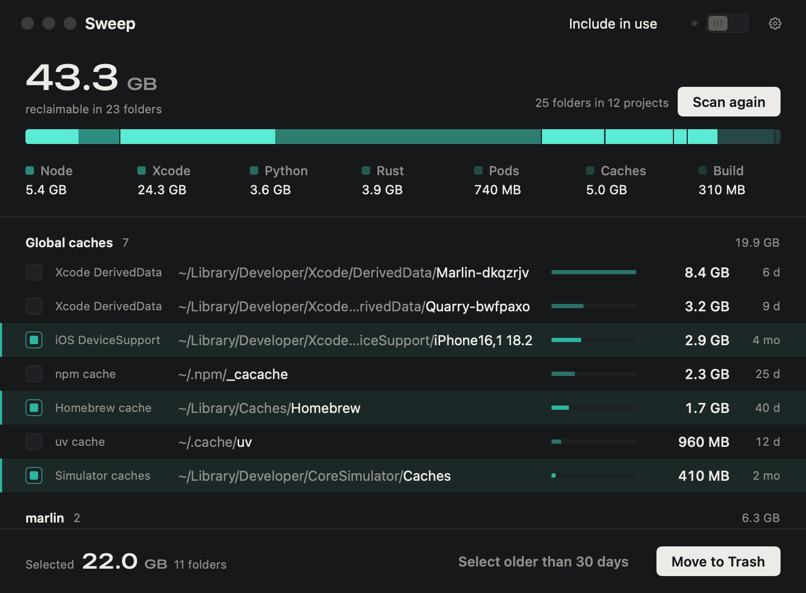

# Sweep

Find rebuildable dev junk on your Mac and choose what to clean up.

<p align="center"></p>

<p align="center">    </p>

Requires macOS 15 or later.

## What it does
- Finds `node_modules`, `.build`, DerivedData, `.venv`, `__pycache__`, `.next`, `target`, `Pods`, ignored `build`/`dist`/`out`, Docker leftovers and global caches (including Gradle, Cargo, Go and pip).
- Finds your project folders by itself (Settings lets you add or remove folders) and scans on first launch.
- Xcode leftovers: archives over 90 days old, older iOS/watchOS/tvOS/visionOS device support, and unavailable simulators.
- Agent disk view: old agent worktrees and session history. Only clean, pushed worktrees can be moved to the Trash; ones with unsaved or unpushed work stay locked.
- Shows what each item is and how big it is. "Last used" comes from the project, so a folder in an active project isn't offered as old.
- Confirmed items go to the Trash, with two exceptions that delete permanently after an extra confirmation: Docker items and unavailable simulators.
- "Free space now" after a sweep empties from the Trash only what Sweep just moved there, after a confirmation. Other things in the Trash stay.
- Folders touched in the last 24 hours are greyed out.
- Optional weekly quiet check with a menu bar dot. It runs on AC power, or on battery at 50% or more.

## Keyboard
| Action | Shortcut |
|---|---|
| Open Sweep | ⌃⌥S |

## Install

**Homebrew**

```
brew tap noterikkirillov8/tap
brew trust noterikkirillov8/tap
brew install --cask sweep
```

**Download**: get `Sweep-1.0.0.zip` from [Releases](https://github.com/noterikkirillov8/sweep/releases), unzip it and drag `Sweep.app` to Applications.

**Build from source**: see below.

Sweep isn't notarised by Apple (that needs a paid developer account), so the first time macOS may say it can't verify the developer: open System Settings → Privacy & Security, scroll down and click Open Anyway (on macOS 15 and later right-click → Open no longer works). The Homebrew cask clears that flag for you.

## How it works
Sweep walks the folders you choose (by default the ones it finds, such as `~/Projects`, `~/Developer`, `~/Code` and `~/Documents/GitHub`), matches a short list of well-known names, and checks a guard for each (for example `node_modules` needs a `package.json` beside it). Symlinks are never followed. Confirmed folders are moved to the Trash with the system API, so you can put them back. Sweep runs `docker` for Docker items, `xcrun simctl` for simulators and `git` (read-only) for the agent disk view.

## Privacy
No network, no accounts, no analytics. Sweep checks folders, Docker, Xcode simulators and git worktrees locally. Cleanup only runs on items you confirm. Docker items (`docker ... prune`) and unavailable simulators (`xcrun simctl delete unavailable`) are deleted for good, and so is anything you empty with Free space now; everything else goes to the Trash.

## Build from source
Needs Xcode 16+ and [XcodeGen](https://github.com/yonaskolb/XcodeGen).

```
scripts/test.sh                  # tests
NO_OPEN=1 scripts/install.sh      # build Release and install to /Applications
```
`scripts/install.sh` signs with the author's local certificate if you have it, and ad hoc otherwise, so it works on any Mac.

## Credits
MIT licence. Interface sounds by Kenney (kenney.nl), CC0.

---
Part of Patchbay: [Harbor](https://github.com/noterikkirillov8/harbor) / [Tally](https://github.com/noterikkirillov8/tally) / [Sweep](https://github.com/noterikkirillov8/sweep) / [Ledge](https://github.com/noterikkirillov8/ledge) / [Switchboard](https://github.com/noterikkirillov8/switchboard) / [Shutter](https://github.com/noterikkirillov8/shutter) / [Reel](https://github.com/noterikkirillov8/reel) / [Vigil](https://github.com/noterikkirillov8/vigil)
